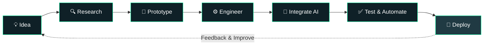

<!-- ═════════════════════ HEADER ═════════════════════ -->

<p align="center">
  
</p>

<p align="center">
  
</p>

<p align="center">
  
  
  
</p>

<p align="center">
  <a href="https://linkedin.com/in/harishb">
    
  </a>
  <a href="mailto:winharishbalu@gmail.com">
    
  </a>
  <a href="https://leetcode.com/harish1171">
    
  </a>
</p>

---

<!-- ═════════════════════ ABOUT ═════════════════════ -->

## `~/about.ts`

```typescript
const harish = {
  name: "Harish Balu",

  education: {
    degree: "B.Tech Information Technology",
    institute: "St. Joseph's Institute of Technology",
    university: "Anna University",
    graduation: 2026
  },

  roles: [
    "Full Stack Developer",
    "AI Engineer",
    "Backend Developer",
    "Automation Engineer"
  ],

  professionalExperience: [
    "Cognizant - QA Automation Intern",
    "Handshake AI - AI Fellowship",
    "Skill First Lab - Backend Intern",
    "Haive - Development Intern"
  ],

  currentlyBuilding: [
    "Autonomous API Testing Systems",
    "AI-powered Document Intelligence",
    "RAG Applications",
    "Intelligent Automation Workflows"
  ],

  currentlyExploring: [
    "LLM Engineering",
    "AI Agents",
    "System Design",
    "Advanced Backend Architecture"
  ],

  philosophy:
    "Understand the problem. Engineer the solution. Automate the process."
};
```

---

## `$ cat engineering-interests.md`

<table>
<tr>
<td width="50%" valign="top">

### ⚡ Backend Engineering

- Node.js & TypeScript
- Python & FastAPI
- REST API Architecture
- Authentication & JWT
- PostgreSQL & MongoDB
- Redis & Caching

</td>
<td width="50%" valign="top">

### 🧠 AI Engineering

- Retrieval-Augmented Generation
- LLM Integration
- Vector Search
- Embeddings
- AI Agents
- Document Intelligence

</td>
</tr>
<tr>
<td width="50%" valign="top">

### 🔬 Machine Learning

- CNN Architectures
- Graph Neural Networks
- Computer Vision
- YOLO Object Detection
- Model Evaluation

</td>
<td width="50%" valign="top">

### 🛠️ Automation & Testing

- Selenium & TestNG
- API Regression Testing
- Jenkins CI/CD
- Workflow Automation
- n8n Integrations

</td>
</tr>
</table>

---

## `$ cat workflow.mmd`



---

## `$ ls ./tech-stack`

<table align="center">
<tr>
<td align="center" width="150"><b>💻 Languages</b></td>
<td>


</td>
</tr>

<tr>
<td align="center"><b>🎨 Frontend</b></td>
<td>


</td>
</tr>

<tr>
<td align="center"><b>⚙️ Backend</b></td>
<td>


</td>
</tr>

<tr>
<td align="center"><b>🧠 AI / LLM</b></td>
<td>


</td>
</tr>

<tr>
<td align="center"><b>🗄️ Database</b></td>
<td>


</td>
</tr>

<tr>
<td align="center"><b>🔧 DevOps</b></td>
<td>


</td>
</tr>

<tr>
<td align="center"><b>🤖 Automation</b></td>
<td>


</td>
</tr>

<tr>
<td align="center"><b>☁️ Cloud</b></td>
<td>


</td>
</tr>
</table>

---

## `$ git log --projects --oneline`

### ⚡ 01. FlowX — Autonomous API Regression Testing Engine

> Engineering automated API testing and regression workflows.

- API workflow creation and execution.
- Automated regression testing.
- API specification integration.
- Testing workflow management.

**Stack:** Node.js · TypeScript · Swagger · API Testing

🔗 **[Explore FlowX](https://github.com/Harishpushpa/FlowX)**

---

### 🧠 02. VitaAgent — Insurance Intelligence Platform

> Transforming insurance documents into structured knowledge.

- PDF and DOCX document processing.
- AI-powered FAQ generation.
- Insurance policy summarization.
- Duplicate detection using SHA-256.
- Background job orchestration.
- Vector embeddings and retrieval.

**Stack:** Python · FastAPI · Node.js · MongoDB · Ollama · Qwen · BGE-M3

---

### 📄 03. Intelligent Document Extraction Service

> Extracting structured information from complex documents.

- OCR using Tesseract and PaddleOCR.
- Document layout detection.
- Table and element extraction.
- PDF and image processing.
- Structured output generation.

**Stack:** Python · PaddleOCR · Tesseract · PP-DocLayout · pdfplumber

---

### 👁️ 04. YOLO Object Detection

> Training and evaluating computer vision models.

- Object detection training.
- Dataset preparation and validation.
- Precision and recall evaluation.
- mAP performance analysis.

**Reported experimental results:**
- mAP50: 0.995
- mAP50-95: 0.9679

**Stack:** Python · YOLO · PyTorch · CUDA

---

### 🌾 05. Commodity Price Regulator — Hybrid ML

> Combining CNN and GraphSAGE for agricultural commodity prediction.

- Agricultural market data analysis.
- Graph-based learning.
- Hybrid deep learning architecture.
- Model performance comparison.

**Reported experimental accuracy:** 94.6%

**Stack:** Python · CNN · GraphSAGE · PyTorch Geometric · TensorFlow

---

### 🌱 06. Farmer Marketplace Platform

> Connecting farmers and middlemen through an intelligent agricultural platform.

- Farmer and middleman interaction.
- Agricultural product marketplace.
- AI-based agricultural support.

**Stack:** React · Node.js · Express · MongoDB

---

### 🎓 07. Student Database Dashboard

> A real-time academic management and analytics application.

- Arrear filters.
- Score comparison.
- Academic dashboard.
- WebSocket-based real-time updates.

**Stack:** React · Node.js · MongoDB · WebSocket

---

### 🤖 08. AI Chatbot for Crop Health

> AI-driven crop disease identification and farming assistance.

**Stack:** Python · NLP · Machine Learning · Computer Vision

---

### 📡 09. GPS-Based Automated Billing System

> Automated transportation fare calculation and invoicing.

- GPS-based route tracking.
- Fare calculation.
- Automated billing.

**Recognition:** Indian Patent Filed (2025).

---

## `$ cat experience.log`

| Organization | Role | Focus |
|---|---|---|
| Cognizant | Intern | Selenium, TestNG, Jenkins, QA Automation |
| Handshake AI | Fellow | AI project workflows and evaluation |
| Skill First Lab | Intern | Backend Development |
| Haive | Intern | Frontend / Backend Development |

---

## `$ cat achievements.log`

```diff
+ 🏆 Winner        : St. Joseph's AI Farming Hackathon
+ 🥈 Second Prize  : Code N' Surge Hackathon
+ 👑 Champion      : Web Development Tournament @ Panimalar
+ 📄 Patent Filed  : Automated GPS-Based Billing System (2025)
+ ⚡ Leadership    : IEEE Chairman
```

---

<details>
<summary><b>🏅 Certifications & Learning</b></summary>

<br/>

- MongoDB for Students — MongoDB University
- Meta Front-End Developer — Coursera
- Express.js — Coursera
- Java Hands-on Guide — Infosys Springboard
- AWS Cloud Practitioner
- Google Cloud Essentials
- Microsoft Azure Fundamentals
- NPTEL — Design Thinking: A Primer
- PwC Tekstac
- DevOps & Git

</details>

---

## `$ ./stats.sh`

<p align="center">
  
  
</p>

<p align="center">
  
</p>

---

## `$ ping harish`

<p align="center">
  <a href="mailto:winharishbalu@gmail.com">
    
  </a>
  <a href="https://linkedin.com/in/harishb">
    
  </a>
  <a href="https://leetcode.com/harish1171">
    
  </a>
  <a href="https://drive.google.com/file/d/1VVKcdxS_damCZWvtnvcge6uwtSTtT_J2/view?usp=drive_link">
    
  </a>
</p>

<p align="center">
  <i>"Turning complex problems into practical engineering solutions."</i>
</p>

<p align="center">
  
</p>

<!-- ═══════════════════ END OF README ═══════════════════ -->
