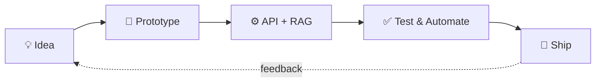

<!-- ═══════════ HEADER ═══════════ -->
<p align="center">
  
</p>

<p align="center">
  <a href="https://github.com/harishpushpa">
    
  </a>
</p>

<p align="center">
  
  
  
</p>

---

## `~/about.js`

```js
const harish = {
  role: ["Full Stack Developer", "AI Engineer", "Backend Engineer"],
  education: "B.Tech IT @ St. Joseph's Institute of Technology (CGPA 8.56)",
  internships: ["Cognizant (QA Automation)", "Skill First Lab (Backend)", "Haive (Frontend)"],
  currentlyBuilding: ["RAG apps", "document-extraction pipelines", "ML projects"],
  currentlyLearning: ["DSA", "AI/ML", "System Design"],
  lookingFor: "entry-level & internship roles",
  funFact: "I break things to learn how they work, then automate the boring parts.",
};
```

---

## `$ cat workflow.mmd`



---

## `$ ls ./tech-stack`

<table align="center">
  <tr>
    <td align="center"><b>🎨 Frontend</b></td>
    <td>
      
      
      
      
      
      
    </td>
  </tr>
  <tr>
    <td align="center"><b>⚙️ Backend</b></td>
    <td>
      
      
      
      
      
    </td>
  </tr>
  <tr>
    <td align="center"><b>🧠 AI / Data</b></td>
    <td>
      
      
      
      
      
    </td>
  </tr>
  <tr>
    <td align="center"><b>🛠️ DevOps & Tools</b></td>
    <td>
      
      
      
      
      
      
    </td>
  </tr>
  <tr>
    <td align="center"><b>💻 Languages</b></td>
    <td>
      
      
      
      
    </td>
  </tr>
  <tr>
    <td align="center"><b>🎬 Design</b></td>
    <td>
      
      
      
    </td>
  </tr>
</table>

---

## `$ git log --projects`

| | Project | What it does |
|---|---|---|
| 🧠 | **MERN RAG System** | Full-stack RAG Q&A app on the MERN stack, deployed live |
| ⚡ | **FastAPI RAG Service** | Production-style RAG backend with FastAPI + FAISS vector search |
| 🌱 | **XcovNet (Ax-SLOA)** | PyTorch soil classification model |
| 🧪 | **API Test Generator** | Upload an API spec → generates & runs RestAssured tests → Extent report |
| 🧾 | **Invoice Extraction** | OCR'd PDF → structured invoice JSON via LLM API |
| 📡 | **GPS Billing System** 🇮🇳 | Real-time fare calc, auto-invoicing & route tracking. **Indian Patent Filed (2025)** |
| 🌍 | **AI Farming Platform** 🏆 | MERN app for agri-product sales with AI decision support. **St. Joseph's Hackathon Winner** |
| 📰 | **Full-Stack News Site** 🥈 | React + Express + MongoDB, real-time API platform. **Code N' Surge, 2nd Prize** |
| 🧑‍💻 | **Interactive Portfolio** 👑 | Animated, mobile-first React UI. **Web Dev Tournament Champion** |

---

## `$ cat achievements.log`

```diff
+ 📄 Indian Patent Filed (2025)  → GPS-Based Billing System
+ 🥇 Winner                      → St. Joseph's AI Farming Hackathon
+ 🥈 Second Prize                → Code N' Surge Hackathon
+ 👑 Champion                    → Web Development Tournament @ Panimalar
```

<details>
<summary><b>🏅 Certifications (click to expand)</b></summary>

<br>

- 📘 **MongoDB for Students**: MongoDB University
- 🟦 **Meta Front-End Developer (5-Course Series)**: Coursera
- 🚀 **Express.js**: Coursera
- ☕ **Java: Hands-on Guide**: Infosys Springboard

</details>

---

## `$ ./stats.sh`

<p align="center">
  
  
</p>

<p align="center">
  
</p>

---

## `$ ping harish`

<p align="center">
  <a href="mailto:winharishbalu@gmail.com"></a>
  <a href="https://linkedin.com/in/harishb"></a>
  <a href="https://www.leetcode.com/harish1171"></a>
  <a href="https://drive.google.com/file/d/1VVKcdxS_damCZWvtnvcge6uwtSTtT_J2/view?usp=drive_link"></a>
</p>

<p align="center">
  
</p>
